# FM27 Face Generator

FM27 Face Generator is a Windows desktop app that gives Football Manager 27 players,
staff and journalists anime-style portraits. It reads a copy of the save, draws on a
local GPU and publishes a graphics pack the game can load.

## Engineering Highlights

| Engineering challenge | Implementation | Measured result |
|---|---|---|
| [Fit SDXL inference in 8 GiB](src/facegen/render/quantise.py) | Store the UNet’s linear-layer weights in INT8. Keep text encoders and the quality tagger in system RAM between uses. | On an RTX 4080, peak VRAM reserved by PyTorch fell from **10.95 to 6.88 GiB** for a full-quality portrait and from **11.82 to 7.70 GiB** for a reference-guided redraw. |
| [Keep the UI responsive during save reads](src/facegen/runtime/sync_process.py) | Move save parsing and database sync from a thread in the desktop app to a child process with its own Python interpreter. | During a 320 MB save sync under WSL2, 90th-percentile latency fell on both the Players page (**1,272 → 77 ms**) and the status endpoint (**2,021 → 153 ms**). |
| [Speed up portrait publishing with Rust](native/src/portrait.rs) | A PyO3 extension releases Python’s GIL and uses Rayon to resize and encode multiple PNGs in parallel. | Republishing a 58-portrait pack took **6.4 s**, down from **57.0 s** (**8.9× faster**), with identical FM portrait mappings. |
| [Query a SQLite catalogue of 181,315 people](src/facegen/persistence/player_queries.py) | Select the 100 IDs for the requested page before joining their details. For the Review filter, find matching jobs once. | Median time for the first page including its count fell from **136 to 52 ms**. With the Review filter, it fell from **155 to 23 ms**. |

<p align="center">
  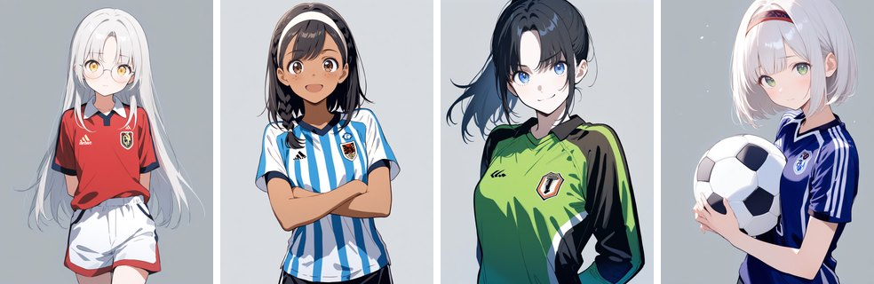
  <br>
  <sub>Four made-up test players, drawn with the same setup the tool uses today.</sub>
</p>

## The problem

Football Manager invents new players every season. Fans call them *newgens*. They arrive
with no photo. A few seasons in, your league is full of faceless
wonderkids, and so is your own academy.

You *can* give them faces by hand: find a picture, name it after the player's ID, add a
line to `config.xml` and reload the skin. That's fine for one player and a chore for
hundreds. It also never ends, because the game keeps making more.

So this tool does the chore:

1. **It reads the save.** It copies your newest save and reads every player, club, CA
   and PA from the copy.
2. **It picks who matters.** You don't look at 20,000 players. You look at your squad,
   your league rivals and the stars. The tool sorts those players into groups A, B and C
   and skips everyone else.
3. **It draws on your GPU.** Each player gets a portrait in their club's kit, made on
   your own graphics card.
4. **It publishes.** It writes the pictures and a `config.xml` into FM27's graphics
   folder. Press *Reload Skin* in FM27 and the faces appear.

## Portrait features

- **A queue instead of brute force.** The GPU is shared with the game, so the tool spends
  it where you'll look. Group A (your club and the superstars) gets the best of 3 tries
  plus a detail pass. Group C (decent players in your league) gets one try. Everyone else
  gets nothing.
- **Faces that grow up.** Each player gets a saved *character sheet* (hair, eyes, skin,
  accessory and so on). When a tracked player changes club or gets older, the tool
  re-draws them from the same sheet. It also shows the model a crop of the old face
  through **IP-Adapter**, a small add-on that lets the model look at a reference picture.
  The result is the same girl in a new kit, a bit older.
- **Nothing leaves your PC.** Models load offline, the web UI answers only on
  `127.0.0.1`, and saves are only ever copied.

## How it fits together

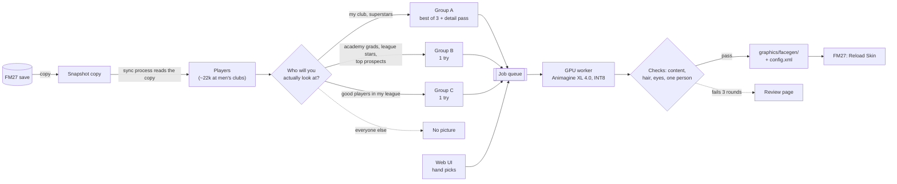

SQLite holds the roster, portrait history and job queue. The desktop app coordinates two
child processes through pipes.

- The **save watcher** starts a sync when a save changes. The **sync process** reads the
  snapshot, updates the roster and queues portraits. Its memory is released when it exits.
- The **GPU worker** draws and checks portraits. It can restart independently after a
  driver error and releases GPU memory when it stops.
- The **FastAPI dashboard** serves the queue, settings and manual requests while a sync runs.
  On native Windows, the Players page took a median of 132 ms at idle and 134 ms
  during a 55-second sync of a 326 MB save.

By default the worker waits while FM27 is running and frees the GPU when you start the
game. Its log is in `data/logs/facegen.log`.

## The constraint

**One RTX 4080 (16 GB), shared with other programs.** Sixteen gigabytes sounds like
plenty, but Windows keeps about 3 GB of it, and FM27 and a browser need room too. The goal
is that a full group A job peaks **under 8 GiB**. An opt-in GPU test fails if the peak
reaches 8.0 GiB.

## Design choices

### 1. Fitting in 8 GB: INT8, offloading and fp16 accumulation

First, a quick map. The image model (from the Stable Diffusion XL family) starts from
noise and cleans it up in 28 steps. The part that does the cleaning is the **UNet**, and it
runs at every step. Around it sit some **helpers**: two text encoders that read the prompt,
a tagger that checks the finished picture, and an image encoder for reference faces. Each
helper works for about a second per job and sits idle the rest of the time.

The setup uses three tricks, each simple on its own.

**Trick 1: store the weights as INT8 and unpack one layer at a time.** The UNet has 700
large matrix layers in its transformer blocks. Each one is stored as INT8 (1 byte per
number instead of 2), with one scale factor per row, so rows with small and large values
both keep their detail. Right before a layer runs, only that layer is unpacked back to
fp16. The layer does its math and the fp16 copy is thrown away. It works like
vacuum-packed clothes: you unpack one outfit when you need it, and the suitcase stays
small.

This takes the UNet weights from **4.78 to 2.75 GiB**. The math itself is still ordinary
fp16, so there are no special kernels and no warm-up.

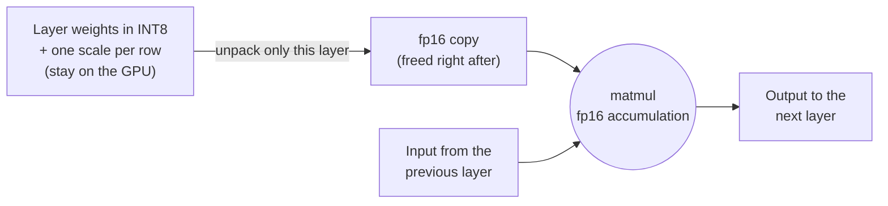

**Trick 2: keep the helpers in system RAM.** The text encoders (1.5 GiB), the tagger and
the face encoder wait in normal memory and move onto the GPU only for the moment they're
needed. Each trip takes time: 0.7 s for the text encoders, 0.2 s for the tagger. So the
text encoders don't make a trip per job. The worker encodes the prompts of the next 32
jobs in one trip and keeps the results (a few MB) in RAM. The model gets exactly the same
numbers as before, so the pictures don't change. What's left is the tagger's two trips, about 0.45 s per job.

**Trick 3: fp16 accumulation.** A matrix multiply adds up a lot of products. By default,
PyTorch adds them up in fp32, and on GeForce cards that runs the fp16 tensor cores at half
speed. One flag (`allow_fp16_accumulation`) makes the GPU add them up in fp16 instead. One
UNet step went from **184 to 145 ms**. The model's output changed by 0.04%, which is less
than switching the whole model to bf16 changes it. The flag is on only while the image
pipeline runs; the text encoders and the tagger keep fp32.

**The result, one step at a time:**

| Setup | One render | Group A player¹ | Peak VRAM² |
|---|---|---|---|
| Plain fp16 | 5.1 s | 19.9 s | 10.95 GiB |
| + fp16 accumulation | 4.1 s | 16.4 s | 10.95 GiB |
| + INT8 weights | 4.4 s | 17.2 s | 9.00 GiB |
| **+ helpers in system RAM (what runs today)** | **4.4 s** | **≈ 17.7 s** | **6.88 GiB** |

¹ Three candidate renders, a detail pass and the checks. The last row adds the ~0.45 s
per job that moving the helpers still costs (~1 s before prompts were encoded 32 jobs at
a time).<br>
² The memory PyTorch reserves at the peak of a whole group A job. fp16 accumulation
doesn't change memory, so the first two rows share one measurement. A re-draw with a
reference face goes from 11.82 to 7.70 GiB (−35%).

To be honest about it, **the big win is memory (−37%)**. Speed is a bonus. Renders are
14% faster, but moving the helpers takes back about 0.45 s per job, so a whole group A
player is about 11% faster. INT8 here is about memory, not speed: unpacking costs a little
time, and fp16 accumulation pays for it.

### 2. Why INT8, and not FP8, torch.compile or SageAttention

I tried every reasonable option on the same 10 made-up players, with the same seeds and
the same prompts, changing only the UNet's arithmetic. "Closeness" measures how near each
picture is to the plain fp16 picture (PSNR; higher means closer). bf16 serves as the
yardstick, because it's a precision change nobody would call harmful.

| Option | Speed-up (group A) | Closeness to fp16 | UNet weights | Start-up wait | Checks passed |
|---|---|---|---|---|---|
| Plain fp16 | 1.00× | (baseline) | 4.78 GiB | none | 20/20 |
| bf16 (the yardstick) | not timed | 24.9 dB | 4.78 GiB | none | 20/20 |
| fp16 accumulation | 1.24× | 30.9 dB | 4.78 GiB | none | 20/20 |
| + torch.compile | 1.26× | 31.7 dB | 4.78 GiB | 112 s | 20/20 |
| + SageAttention | 1.30× | 22.5 dB | 4.78 GiB | none | 20/20 |
| FP8 + torch.compile | 1.36× | 20.8 dB | 2.75 GiB | 192 s | 18/20 |
| INT8 weights and activations + torch.compile | 1.38× | 23.4 dB | 2.75 GiB | 184 s | 20/20 |
| **INT8 weights + fp16 accumulation (chosen)** | **1.16×** | **25.9 dB** | **2.75 GiB** | **none** | **20/20** |

The chosen setup is not the fastest. It won for four reasons.

**1. You can't see the difference.** Its pictures are closer to fp16 than bf16's are.
Here are two of the test players side by side:

| Plain fp16 | INT8 + fp16 accumulation |
|---|---|
| 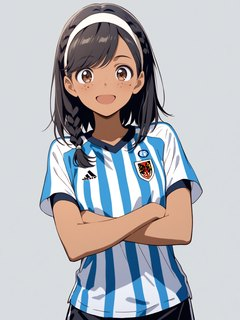 | 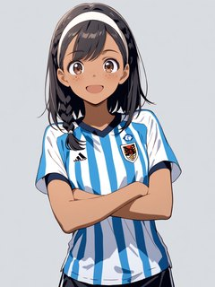 |
| 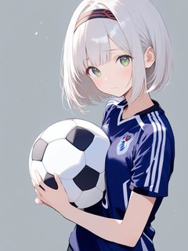 | 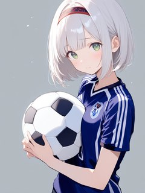 |

**2. The theory agrees.** INT8 with one scale per row keeps about 7 bits of precision,
while FP8 (E4M3) has 3 mantissa bits. On the 4080, INT8 math is at least as fast as FP8
(on paper they have the same peak), so FP8 would add error without adding speed. The test
showed exactly that: FP8 was as fast as INT8 with twice the error, and it lost one
player's hair colour.

**3. There's no warm-up.** The fastest rows need `torch.compile`, which takes about
3 minutes every time the worker starts. The worker restarts often, because it releases
the GPU whenever you open FM27. At about 3 s saved per player, it would have to draw more
than 60 group A players in one sitting before the wait paid off.

**4. There are no extra dependencies.** SageAttention is a little faster, but it adds a
package and moves the pictures further from fp16 than bf16 does.

### 3. Picking the model

<table>
  <tr>
    <td align="center">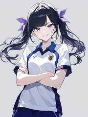<br><strong>Animagine XL 4.0 Opt</strong></td>
    <td align="center">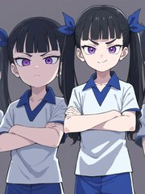<br>Illustrious XL 2.0</td>
    <td align="center">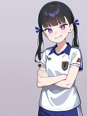<br>NoobAI-XL 1.1</td>
    <td align="center">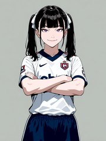<br>Anima Aesthetic v1.1</td>
  </tr>
  <tr>
    <td align="center">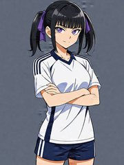<br>Z-Image (6B, FP8)</td>
    <td align="center">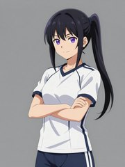<br>Z-Image-Turbo (FP8)</td>
    <td align="center">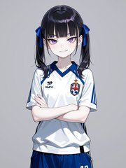<br>WAI-illustrious v17</td>
    <td align="center">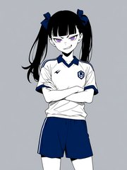<br>Anima-2.9B (preview)</td>
  </tr>
</table>

### 4. Spend the GPU where you look: groups A, B and C

A save holds tens of thousands of players (21,834 at men's clubs in my test career), but
you mostly look at three kinds: **your own squad**, **the teams you play every week**, and
**the stars** who keep turning up in the news and in scouting. Those players get pictures,
the ones you see most often get the best pictures, and everyone else is skipped.

| Group | Who (default thresholds) | Tries | Detail pass | Published size |
|---|---|---|---|---|
| **A** | Your first team and your staff; any newgen with CA > 155 or PA > 170 | best of 3 | yes | 768×1024 |
| **B** | Your other teams (reserves, under-23s, under-18s); your academy graduates after they leave; newgens with CA > 130 or PA > 150 who are in your league or a continental cup; any newgen with CA > 140 or PA > 155; journalists from your club's country and your press officers | 1 | no | 576×768 |
| **C** | Newgens in your league with CA > 115 or PA > 140; the other clubs' managers in your league who have no photo | 1 | no | 384×512 |
| none | Everyone else | no picture, unless you pick them by hand in the web UI | | |

- **Real players without a photo count as newgens.** FM27 ships photos for some leagues
  only; everyone else shows a silhouette. At each sync facegen reads the game's list of the
  photos it ships and the `config.xml` of any facepack you installed, and a real player with
  neither is picked by the same thresholds as a newgen (the academy rule aside). Settings
  turns this off.
- **Queue order:** your hand-picked requests come first, then group A (newest arrivals at
  your club first, so youth intake day goes to the front), then B, then C, each sorted by
  PA.
- **Cost:** a group A player takes about 18 s. A B or C player takes a single render
  (~4.4 s) plus the check.
- **Why B and C still render at full size:** image models draw *worse*, not just smaller,
  below their native size. So every group renders at full size. The groups differ in how
  many tries they get, whether they get the detail pass, and how big the published file
  is.
- **Smaller graphics cards:** Settings → "Auto-configure for my GPU" asks the card and
  proposes picture settings for it: below 10 GB, best of 2 with no detail pass and the
  picture decoded in tiles; 10 and 11 GB, a smaller detail pass (1152×1472 instead of
  1344×1728). It lists each change first, saves them as one change that one Undo reverts,
  and never touches who gets a picture. On the RTX 4080 a group A job peaks at about
  6.9 GiB of PyTorch memory with the defaults, 5.8 GiB with the 10–11 GB preset and 4.5 GiB
  with the under-10 GB one (7.7, 6.7 and 5.0 GiB for a re-draw with a reference picture);
  they are not yet tried on smaller cards.
- **Club colours.** A hand-tuned kit table takes priority. For 832 clubs, the app also
  ships colour estimates from FM27’s home shirt images. Clubs missing from both sources
  get a neutral kit. [Kit catalogue](src/facegen/data/kit_catalog.json)
- **A new photo shoot each time.** The character sheet keeps a player's face, hair and
  eyes; each picture draws the rest. The kit is worn with short, long or layered sleeves,
  a collar, or as club training wear: a track jacket, open over the shirt or zipped to a
  high collar. The in-game date sets the season, so winter brings more long sleeves and
  jackets. Each player has a favourite style, and seniors now and then wear an armband.
  Poses combine arms and an angle (front, a turn, a head tilt, contrapposto), and the
  backdrop is a plain colour, a gradient or two tones, never the kit's or hair's colour.
- **Your staff too.** Coaches, physios, scouts, the board and your own manager get group A
  pictures, dressed for the job: suits and overcoats for the board, a suit or a bench coat
  for the manager, training wear and a whistle for coaches, lab coats for doctors, with the
  club's colours on a tie, scarf or jacket. Their age wording has its own table of
  very wide, seven-year bands, so most staff fall in the middle of the range.
- **The people around the club.** Journalists and press officers get one picture each, in
  work clothes with a press pass or a lanyard. The other clubs' managers in your league
  get one too if FM27 has no photo of them. Pin someone you see often to group A and they
  are kept up to date like your own staff.
- **Thresholds are live.** Each setting is saved as you change it in the web UI, the page
  says who moved and what was queued, and Undo puts it back, several steps at once if you
  like. Newly eligible players join the queue, and existing pictures are never deleted.

### 5. Faces that grow up

A player who changes club or gets older should still look like themselves. Three things
make that work:

1. **A character sheet for each player:** hair colour and style, fringe, eye colour and
   shape, skin, accessory, mark and default expression. All randomness is seeded from the
   career, the player's ID and a version number, so the same inputs always give the same
   sheet and the same prompt. A fun extra: personality nudges the expression. High
   *Pressure* leans confident, and high *Professionalism* leans serious.
2. **Age wording:** the player's real age picks one of ten age descriptions for the
   prompt. When a tracked player's age moves into the next band, they're re-drawn.
3. **The old face as a reference:** when a player at your club is re-drawn, the tool crops
   the face from their current picture and gives it to **IP-Adapter plus-face** at a
   gentle strength of 0.1. I tested strengths from 0.1 to 0.8. From 0.4 up, kit accuracy
   dropped by 5–10 points, and an adapter that looked at the whole picture carried the old
   club's shirt into 30% of the new pictures. 0.1–0.2 gave the closest faces with no loss
   in kit accuracy. The reference stays gentle because any reference holds back the aging
   a little.

| Age 22 | Age 27 | Age 31 |
|---|---|---|
| 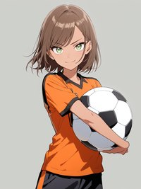 | 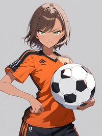 | 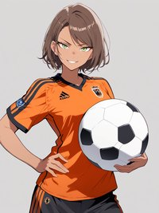 |

<sub>One test character drawn at three ages, each from the same sheet with her original
picture as the reference.</sub>

## Numbers

GPU timings were measured under WSL2 on the RTX 4080 while Windows shared the card.
Its speed drifted by up to 40% within minutes, so render-speed comparisons alternated the
baseline and variant runs and used the median.

| What | Result |
|---|---|
| Loading the model from disk (incl. INT8 conversion) | ~6 s |
| One render, 896×1152, 28 steps | 4.4 s |
| Detail pass, 1344×1728 | 4.0 s |
| Content and quality check | 0.03 s per picture |
| One group A player (3 renders + detail pass + checks) | ~18 s |
| Peak VRAM for a group A job | 6.9 GiB (7.7 GiB with a reference face) |
| GPU memory held between jobs | ~3.8 GiB; all freed after 5 idle minutes or when FM27 starts |
| First real squad run (Colchester, 52 players) | 154 of 156 candidates passed; all 52 players passed in the first round (19 min, before the speed-ups) |
| Reading and sorting a save | ~10 s for a 59 MB save, 55 s for a 320 MB save |
| Web UI players list, 33,000-player database | 5–40 ms per page |

The SQLite benchmark used a copy of a career with 181,315 people and added 40,000 synthetic
jobs to exercise queue and review filters. Timings are medians of seven warm runs. The
query rewrite returned identical results across 446 filter, sort and page combinations.
[SQLite benchmark](scripts/spikes/sqlite_indexes.py)

## Development

See the [project guide](AGENTS.md) for source setup, the repository layout and development
commands. From a prepared checkout, `uv run facegen sync --dry-run` previews who would get a
portrait and `uv run facegen status` shows careers and queued work.

### Tests

The default suite runs offline on synthetic data. It covers unit and integration
behaviour and checks parity between the Python and Rust image paths when both are
installed. [Test suite guide](tests/AGENTS.md)

```bash
env -u FACEGEN_TEST_GPU -u FACEGEN_TEST_SAVE HF_HUB_OFFLINE=1 TRANSFORMERS_OFFLINE=1 \
  uv run --no-sync pytest -ra
```

With cached models, the opt-in GPU tests also check rendering, reference faces, encoding
equivalence and the 8 GiB budget: one file per image model (`test_gpu.py` for Animagine,
`test_gpu_realvis.py`, `test_gpu_zimage.py`), and `test_gpu_jobs.py` for whole jobs with
every model and gender. Run one file at a time.

```bash
FACEGEN_TEST_GPU=1 uv run --no-sync pytest tests/opt_in/test_gpu.py
```

### Release and source layout

The Windows release workflow runs the tests, builds the installer with Inno Setup and
publishes the executable with a SHA-256 checksum. [Release workflow](.github/workflows/release.yml)

| Path | Contents |
|---|---|
| [src/facegen/](src/facegen/) | Python pipeline, GPU renderer, FastAPI dashboard and desktop app |
| [native/](native/) | Rust image processing exposed to Python through PyO3 |
| [config/](config/) | Default settings and club kit colour overrides |
| [scripts/spikes/](scripts/spikes/) | Experiments behind the GPU and SQLite measurements |
| [tests/](tests/) | Unit, integration, parity and opt-in tests |
| [installer/](installer/) | Windows installer and payload staging |

## Known Limits

- **Platform coverage.** Tested on one RTX 4080 PC with the Steam edition of FM27, under
  native Windows and WSL2. Other GPUs, fresh installs on other PCs, and the Epic and Game
  Pass editions are unverified.
- **Save compatibility.** Game patches can change the save format. The dashboard identifies
  unreadable builds and keeps existing portraits. The reader is pinned to
  [fmsave 0.12.6](https://github.com/rhiever/fmsave).
- **Portrait fidelity.** Animagine XL 4.0 is the supported model. Kits approximate club
  colours and patterns. A reference face helps preserve a player’s identity across redraws,
  but the save reader exposes no newgen hair or skin data to match the in-game 3D face.
- **Coverage and validation.** Group B’s continental-cup rule still needs competition IDs.
  Automatic save watching and age or transfer redraws still await final in-game verification.

## Install on Windows

Download and run `facegen-setup-<version>.exe` from the [latest Windows release](https://github.com/junepaykim/face-generator/releases/latest).

You’ll need 64-bit Windows 10 or 11, FM27, an NVIDIA GPU with about 8 GB of VRAM and about
20 GB of free disk space. First launch sets up Python and PyTorch (~3 GB), then asks before
downloading the models (11.6 GB). After the first portraits are published, choose **Reload
Skin** in FM27 to see them.

### Updates

The dashboard checks daily. **Update now** installs a new version and keeps your portraits,
database and settings. You can turn off daily checks in **Settings → Advanced → Updates**.

### Uninstall

Remove **facegen** from **Windows Settings → Apps**. The uninstaller lets you keep or remove
the FM graphics pack and local app data separately. Downloaded models stay in the shared
Hugging Face cache.

---

The code is under the [MIT License](LICENSE).

<sub>Not affiliated with Sports Interactive or SEGA. Model weights are not included, and
each model has its own licence.</sub>
